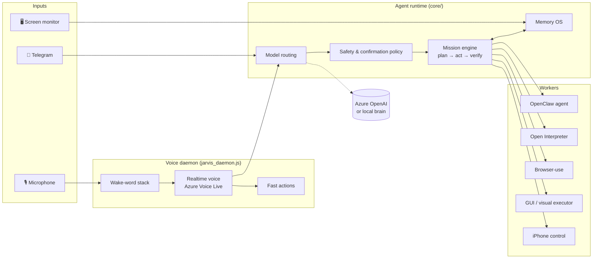

<div align="center">

# 🤖 JARVIS

**A personal, voice-first AI assistant for macOS that talks, sees your screen, controls your Mac and iPhone, and runs long-lived autonomous missions.**


</div>

---

## Overview

JARVIS is an always-on assistant that runs as a set of background services on a Mac. Say **"Jarvis"** and it answers in real time. You can interrupt it mid-sentence and it stops talking to listen. Behind the voice layer sits an agent runtime that can:

- **Act on your computer.** It opens apps, manages files, browses the web, clicks through GUIs and controls an iPhone via iPhone Mirroring. Destructive actions can be undone.
- **Run missions.** These are multi-hour or multi-day goals. JARVIS plans them, delegates them to specialised workers, checks each step against evidence and reports back.
- **Stay reachable remotely.** A Telegram bot accepts text, voice notes and video notes, and sends short status updates and a daily morning brief.
- **Remember things.** Long-term memory lives in Obsidian and PostgreSQL, with embeddings-based recall.
- **Run on cloud or local models.** It uses Azure OpenAI by default and can switch with one command to a local multi-model "brain" (Qwen / Gemma / Bonsai) with a RAM-aware arbiter.

The assistant is built for a bilingual owner, so speech recognition and replies are tuned for **Uzbek and English**. The tuning includes a custom speech normalizer, a transcript corrector and a personal wake-word model.

## Highlights

| Area | What's inside |
|---|---|
| 🎙️ **Real-time voice** | Azure Voice Live full-duplex sessions, barge-in detection, echo cancellation via a native Swift audio helper, and a layered wake-word stack (openWakeWord, Whisper and a personal model you train) |
| 🧠 **Model routing** | Fast and strong deployments with automatic fallback, a deep-think mode, and a local brain service that keeps exactly one large model in RAM at a time |
| 🛠️ **Autonomous missions** | Planner → executor → verifier loop over pluggable workers: `agent`, `interpreter`, `browser`, `gui`, `phone`, `babyagi`, `autogpt`, `think` |
| 👁️ **Visual action loop** | Screenshot → plan → act → verify, with macOS Accessibility grounding and a deterministic action benchmark |
| 🔐 **Safety** | A configurable confirmation policy, an action safety classifier, allowlisted smart-home scopes, owner-only Telegram access, undo, and a secret scanner |
| 📱 **Integrations** | Telegram, Gmail, Google Calendar, Home Assistant, iPhone Mirroring, Obsidian, Open Interpreter, browser-use |
| 🩺 **Operability** | A `doctor` health check, a self-healing watchdog, a voice flight recorder, runtime telemetry, a local web dashboard, launchd autostart and daily backups |

## Architecture



## Requirements

**Hardware and OS:** a Mac running macOS 13 or newer. It is tested on Apple Silicon. iPhone control needs macOS 15+ on Apple Silicon. You also need about 8 GB of free disk space and an internet connection.

**Accounts and keys.** The installer asks for each of these and validates it on the spot.

| Service | Purpose | Where to get it |
|---|---|---|
| **Azure OpenAI** (endpoint, key, deployments) | The agent's brain: a fast model for simple requests and a strong model for tool use and complex tasks | [Azure AI Foundry](https://ai.azure.com) → project → *Endpoints and keys* → *Deploy model* |
| **Azure Voice Live** (`gpt-realtime`) | Real-time voice conversation | Deploy `gpt-realtime` in the same Foundry project |
| **Azure Speech** (key and region) | Speech-to-text and text-to-speech | Azure portal → *Speech service* → *Keys and Endpoint* |
| **Telegram bot** *(optional)* | Remote control and notifications | [@BotFather](https://t.me/BotFather) → `/newbot` |
| **Google OAuth** *(optional)* | Gmail and Calendar | [Google Cloud Console](https://console.cloud.google.com/apis/credentials) → OAuth client (Desktop) → download the JSON |
| **Home Assistant** *(optional)* | Lights, switches, climate, media and other smart-home devices | Create a *Long-Lived Access Token* in your Home Assistant profile |

> 💸 Voice sessions and autonomous missions incur Azure costs, especially in always-listening mode. JARVIS sends a Telegram alert when spending crosses your budget. The alert does not stop any work.

## Installation

```bash
git clone https://github.com/miraziz-Developer/OPEN_CREW_JARVIS.git
cd OPEN_CREW_JARVIS
./install.sh
```

Or without cloning first:

```bash
bash <(curl -fsSL https://raw.githubusercontent.com/miraziz-Developer/OPEN_CREW_JARVIS/main/install.sh)
```

The installer runs these steps in order:

1. **Checks the machine:** macOS version, chip, disk space and network. `./install.sh --check` runs only this step and changes nothing.
2. Installs the Xcode Command Line Tools and Homebrew if they're missing. It asks first.
3. Installs the Homebrew packages (Node, Python 3.11/3.12, sox, ffmpeg, cliclick, yt-dlp, uv, whisper-cpp) and the OpenClaw agent.
4. **Asks for each key in turn.** Input is hidden, and each key is tested as soon as you enter it (✅ / ❌). Keys are written only to a local `.env` with permissions `0600`, which git ignores.
5. Asks you to pick a confirmation mode (see [Safety modes](#safety-modes)).
6. Builds the wake-word models, the autonomous workers (Python environments and a browser) and the native echo-cancelling audio helper for your machine.
7. Enables launchd autostart and starts JARVIS.
8. Runs `doctor` and offers to open the required macOS permission panes.

Re-running the installer is safe because keys that are already set are kept. Use `./install.sh --reconfigure` to start over. Use `./install.sh --skip-workers` to defer the heavy workers, and install them later with `bash scripts/install-workers.sh`.

### macOS permissions

Only you can grant these. Open **System Settings → Privacy & Security** and enable **Microphone**, **Accessibility**, **Automation** and **Screen Recording** for *Terminal* (or `node`). Then run `./jarvis restart`.

## Getting started

1. Run `./jarvis status`. It should report `running` and show the dashboard URL. For a full check, run `npm run doctor`. All green means you're ready.
2. Say **"Jarvis"** and it should answer. In always-listening mode it only responds when it hears its name.
3. If you connected Telegram, send `/start` to your bot. If `TELEGRAM_OWNER_IDS` is empty, the first person to message the bot becomes the owner.
4. *(Optional, ~5 minutes)* Train the wake word on your own voice for better recognition: run `npm run voice:wake-collect`, then `npm run voice:wake-train`.

## Usage

### Voice

| Say | What happens |
|---|---|
| "Jarvis, open Safari" · "close Telegram" · "turn the volume down" | App and system actions, in about a second |
| "Play Billie Jean on YouTube" · "search Google for …" | Web actions, in about 2 seconds |
| "Move report.pdf to Documents" · "**undo**" | File actions. *Undo* reverts the last one, and deletions go to the Trash |
| "Remind me tomorrow at 9" · "what's on my calendar?" | Reminders and calendar (needs Google) |
| "Check my mail" | Gmail (needs Google) |
| "**Start a mission:** every morning find remote Python jobs and rank them" | A long-running goal: plan, then execute, then verify, in the background |
| "Mission status?" · "pause / resume / cancel mission 3" | Mission control |
| "Check WhatsApp on my phone" | Sees and controls the iPhone via iPhone Mirroring |
| "stop" | Stops speaking immediately |

Conversation is full-duplex: if you talk while JARVIS is speaking, it stops and listens. Replies are short on purpose.

**Fn + Shift** pauses or resumes JARVIS entirely, microphone included. If `doctor` reports *"JARVIS is paused"*, this is why.

### Telegram

Send the bot text, a **voice message** or a round video note. The agent replies and does the work. Requests like "take a screenshot" or "find this file and send it to me" work too. You get a **short message** when a mission finishes, gets blocked or goes over budget, plus a **morning brief** with missions, calendar and mail.

### Missions

A mission is a goal that runs for hours or days. JARVIS splits it into steps and assigns each step to a worker:

| Worker | Handles |
|---|---|
| `agent` | General computer tasks through the OpenClaw agent |
| `interpreter` | Code and terminal work (Open Interpreter) |
| `browser` | Web automation (browser-use) |
| `gui` | Screen-level interaction through the visual action loop |
| `phone` | iPhone control |
| `babyagi`, `autogpt` | Open-ended research loops |
| `think` | Deep reasoning without side effects |

Every step is verified against evidence before it counts as done. To check progress, ask *"mission status"* or open the dashboard at <http://localhost:7890>.

### iPhone control

You need macOS 15+, Apple Silicon, and an iPhone signed in to the same Apple ID. One-time setup: open *iPhone Mirroring* and approve it with Face ID. After that, say *"on my phone, …"*. JARVIS reads the phone screen, taps and types. If the phone is locked or out of range, it tells you it isn't connected.

### Safety modes

Set `JARVIS_CONFIRM_MODE` in `.env`:

| Value | Behaviour |
|---|---|
| `payments` *(recommended)* | Asks for a spoken "confirm" only for money and payments |
| `strict` | Also confirms sending email, deleting files, submitting forms and other risky actions |
| `off` | Never asks. JARVIS carries out **payments and deletions too** on its own |

Apply the change with `./jarvis restart`.

### Optional integrations

```bash
node scripts/google-oauth-setup.js          # Gmail + Calendar (needs client_secret*.json in ~/Downloads)
python3 scripts/chrome-profile-sync.py      # let the browser worker use your Chrome profile
node scripts/set-brain.js local             # switch to local models (Qwen / Gemma / Bonsai); "cloud" switches back
```

## Command reference

| Command | Description |
|---|---|
| `./jarvis status` | Show whether services are running |
| `./jarvis start` · `stop` · `restart` | Lifecycle control |
| `./jarvis logs` | Tail the live logs (stored under `logs/`) |
| `./jarvis open` | Open the dashboard |
| `./jarvis update` | Pull the latest version and restart |
| `./jarvis reconfigure` | Re-enter API keys |
| `./jarvis uninstall` | Remove autostart and services. Code and data are kept |
| `npm run doctor` | Full system health check |

A backup runs automatically every day at 03:30 (`scripts/backup.sh`).

## Troubleshooting

| Symptom | Fix |
|---|---|
| No response to "Jarvis" | Check the microphone permission and run `npm run doctor`. Is JARVIS paused (Fn + Shift)? Run `npm run diagnose:voice` |
| `doctor`: "JARVIS is paused" | Press Fn + Shift or run `./jarvis start` |
| Telegram is silent | Check `TELEGRAM_BOT_TOKEN` in `.env`, send `/start` to the bot, then check `./jarvis logs` |
| "gateway" shows red | Run `./jarvis restart`, or try starting `openclaw gateway` manually |
| Choppy or distorted audio | Run `bash scripts/build-voice-io.sh` to rebuild echo cancellation, then `./jarvis restart` |
| Agent doesn't see skills | Run `bash scripts/sync-workspace.sh` (it also runs on every start) |
| Rotated an API key | Edit `.env`, then run `./jarvis restart` |

Logs are written to `logs/daemon-YYYYMMDD.log` and `logs/mission-runner.stdout.log`.

## Configuration

[`.env.example`](.env.example) lists every setting with empty secrets. The most important ones:

| Variable | Meaning |
|---|---|
| `AZURE_OPENAI_*` | Agent and mission model |
| `AGENT_FAST_MODEL` | Deployment for simple, latency-sensitive requests |
| `AGENT_STRONG_MODEL`, `AGENT_STRONG_FALLBACK_MODELS` | Primary and fallback deployments for coding, tool use and complex tasks |
| `AZURE_VOICELIVE_*`, `AZURE_SPEECH_*` | Voice |
| `TELEGRAM_BOT_TOKEN`, `TELEGRAM_OWNER_IDS` | Telegram bot and the owners allowed to control it |
| `JARVIS_CONFIRM_MODE` | Confirmation policy (see [Safety modes](#safety-modes)) |
| `JARVIS_ALWAYS_LISTEN` | `true` for always-listening, otherwise wake on demand |
| `MISSION_DAILY_TOKEN_BUDGET` | Daily token alert threshold (it notifies but never blocks) |
| `MORNING_BRIEF_HOUR` | Hour of the morning brief (default `8`) |
| `HOME_ASSISTANT_URL`, `HOME_ASSISTANT_TOKEN` | Optional Home Assistant connection |
| `HOME_ASSISTANT_ALLOWED_DOMAINS`, `HOME_ASSISTANT_ALLOWED_ENTITIES` | Allowlists for which devices JARVIS may touch |
| `HOME_ASSISTANT_ALLOW_SECURITY_ACTIONS` | Locks, alarms and covers. Default `false`, and explicit confirmation is required even when enabled |

## Project structure

```
.
├── install.sh, jarvis      Installer and service CLI
├── jarvis_daemon.js        Voice daemon: microphone, wake word, realtime sessions
├── telegram-bot.js         Telegram bot
├── core/                   Runtime: missions, workers, model routing, safety policy,
│   ├── brain/              local multi-model brain with a RAM arbiter
│   ├── missions/           mission engine, store and API
│   ├── workers/            Python and Node worker adapters
│   └── background-jobs/    scheduled jobs (briefs, synthesis, proactive checks)
├── skills/                 Agent and voice skills (memory, gmail, calendar,
│                           desktop/phone control, realtime-voice, ...)
├── native/                 Swift audio I/O helper with echo cancellation
├── dashboard/              Local web dashboard (localhost only)
├── scripts/                Setup, doctor, update, backup, launchd, wake-word training
├── benchmarks/             Action and pronunciation corpora
├── requirements/           Pinned Python environments for each worker
├── tests/                  Node test suite (`npm test`)
└── docs/                   In-depth design notes
```

## Security and limitations

- **macOS only.** The microphone, screen capture, iPhone Mirroring and launchd integration are all macOS-specific. Intel Macs are untested.
- Secrets, tokens, voice recordings and personal data are git-ignored. If a key ever leaks into the repository, rotate it immediately. `npm run security:scan` helps catch leaks.
- The Telegram bot only responds to `TELEGRAM_OWNER_IDS`. The dashboard has no authentication, so never expose it beyond `localhost`.
- JARVIS can control your computer and phone. Set `JARVIS_CONFIRM_MODE=off` only if you really want that.
- Some macOS permissions can only be granted by you. The installer never grants them automatically.

## Development

```bash
npm test                 # unit tests: no real .env, network or Telegram needed
npm run check            # syntax-check every entry point, then run the tests
npm run security:scan    # scan the tree for leaked secrets
npm run benchmark        # offline benchmarks
npm run benchmark:model  # model-routing benchmark (offline); --live measures Azure latency and quality
```

Further reading:

- [docs/autonomy.md](docs/autonomy.md): the autonomy model, mission lifecycle and verification
- [docs/memory-postgresql-migration.md](docs/memory-postgresql-migration.md): moving memory to PostgreSQL
- [docs/owner-task-controls.md](docs/owner-task-controls.md): owner controls for long-running tasks
